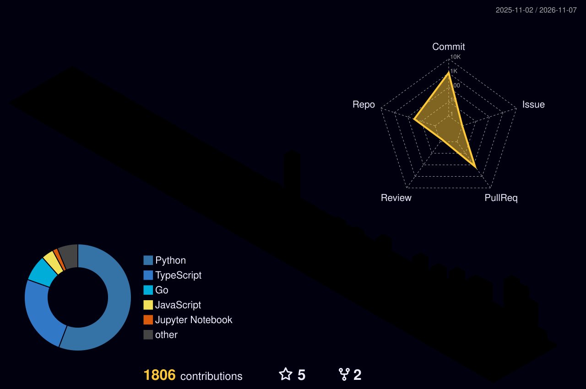

<!--
  Setup, once:
    1. Commit header.svg, otav.svg, stack.svg, linkedin.svg and mail.svg next to this file,
       at the repo root, in abhishek-pandey7/abhishek-pandey7
    2. If your default branch is "master", swap main -> master in the image URLs
    3. header-ascii.txt is a plain-text version of the header, if you ever
       want a code block instead of the animated SVG
-->

  

  
  &nbsp;&nbsp;
  &nbsp;&nbsp;
  &nbsp;&nbsp;

A system that acts on your behalf should be able to say what it saw, what it decided, and why the next step followed from the last one. That is what the work below has in common: an agent that plans its steps and asks before anything it cannot undo, a wealth tracker that derives every number from a ledger, a radar scheduler that can show the score behind every look it takes, a benchmark harness that measures where long context actually fails, and a handful of production systems built for people who are not going to read the logs.

**01** [Experience](#experience) &nbsp;&nbsp;&middot;&nbsp;&nbsp; **02** [Featured](#featured), three builds &nbsp;&nbsp;&middot;&nbsp;&nbsp; **03** [Other projects](#projects) &nbsp;&nbsp;&middot;&nbsp;&nbsp; **04** [Research](#research) &nbsp;&nbsp;&middot;&nbsp;&nbsp; **05** [Stack](#stack)

---

## Experience

<table>
<tr>
<td width="190"><b>Jireh Studios</b> Co-Founder & Software Lead</td>
<td>Four products across travel, commerce and operations. The largest is Misba, a 205k-LOC production travel and OTA platform (three NestJS services behind five Angular portals, 20+ GDS and consolidator integrations across seven verticals, query logic centralised in an internal GraphQL data-graph and exposed as REST facades), where my work is defect triage and maintenance rather than authorship. MSAG I own end to end: edge-native on Hono and Cloudflare Workers with Neon serverless Postgres, a request-scoped Prisma client on AsyncLocalStorage and an ES6 Proxy so concurrent requests sharing a V8 isolate stop leaking state into each other, and 15MB artwork scans that upload straight to R2 through presigned URLs without touching compute. Astro islands serve the storefront, React 19 the admin console. Sunzee Holidays, below, is mine too, as is Kirana Commerce, a three-role grocery operations prototype where money is integer paise and weight integer grams, because nothing that floats belongs near a bill.</td>
</tr>
<tr>
<td><b>Global Pathway Solutions</b> SWE & AI Research Intern</td>
<td>Prototyped hybrid OCR parsers, multi-model Socratic dialogue systems, and high-performance retrieval engines for EdTech platforms, under an Agile Scrum workflow. Currently scoping an agentic marketing pipeline for competition outreach: a research pass that combines the quantitative records already held in-house with scraped qualitative signal from vetted sources (participating nations and schools, skills a competition actually tests, difficulty banding, past entrant testimonials), feeding a generation pass that rewrites the existing brochure collateral into short-form copy, WhatsApp posts, long-form email, a spoken script, and multiple ad variants for A/B testing.</td>
</tr>
<tr>
<td><b>Naturavest</b> AI Automation Engineer</td>
<td>Built a two-stage WhatsApp retention system on n8n and Shopify that works out when a customer will run out of what they bought, then messages them twice: two days before, and two days after. Intake is an order webhook that derives total lifespan from a product metafield, the quantity, and a regex-parsed pack multiplier ("Pack of 3"), falling back to 30 days when the metafield is unset, and writes both target dates back onto the order. Dispatch is a daily cron that batch-queries Shopify by date-stamped order tag, routes pre-runout and post-runout to different WhatsApp templates, and untags on send. No database and no job scheduler anywhere in it: the tag is the queue, and removing it is what stops a customer being messaged twice.</td>
</tr>
<tr>
<td><b>DJ Init.AI</b> AI Research Mentee</td>
<td>Built evaluation harnesses and studied long-context reasoning failure modes in frontier LLMs. Write-up under Research, below.</td>
</tr>
</table>

**B.Tech Information Technology**, DJ Sanghvi College of Engineering, Mumbai &nbsp;&middot;&nbsp; CGPA 9.155/10.0 &nbsp;&middot;&nbsp; expected May 2028

---

## Featured

### AURA
*Autonomous agent for the shell, the browser and the desktop*

Most agent demos work once, on the recorded run, at the recorded resolution. AURA takes a plain-English goal, plans it into up to ten ordered subtasks, then works through each one in a ReAct loop across 35 tools, reading every result before it chooses the next step. It acts as you, in your real Chrome profile and Google account, and it stops and asks before anything it cannot undo.

  

<table>
<tr><td width="190"><b>Desktop perception</b></td>
<td>Native Windows OCR turns the screen into a map of every text line and its pixel position, so the agent can click by coordinates in apps with no API, and reading the screen costs no tokens. A vision model is the fallback for purely graphical screens.</td></tr>
<tr><td><b>Watch and learn</b></td>
<td>Record yourself doing a task once. A vision model turns the clicks, keystrokes and screenshots into a Python tool, which registers on the spot with no restart.</td></tr>
<tr><td><b>Browser and accounts</b></td>
<td>Drives your real Chrome profile with Playwright, logins and cookies included, and reaches Gmail, Calendar, Meet and Forms over OAuth.</td></tr>
<tr><td><b>Guardrails</b></td>
<td>Deletes, <code>sudo</code>, <code>git push</code> and package installs always ask, even with safe mode off. A 30-iteration cap stops a confused model from looping forever, and sessions save after every message so an interrupted run can resume.</td></tr>
</table>

`Python` `Playwright` `Windows OCR` `OpenAI-compatible LLMs`

[repo &rarr;](https://github.com/abhishek-pandey7/AURA-Automated-Realtime-Assistant) &nbsp;&middot;&nbsp; [PyPI &rarr;](https://pypi.org/project/aura-autonomous-agent/)

### Folio
*Personal wealth tracker for Indian and US markets*

For anyone holding Indian and US assets across several brokers. Folio values NSE and US stocks, ETFs and Indian mutual funds live, converts between INR and USD, and treats a transaction ledger as the only source of truth: holdings, cost basis, realized gains and XIRR are always derived from history, never edited by hand.

  

<table>
<tr><td width="190"><b>Ledger</b></td>
<td>Money stays decimal end to end: <code>NUMERIC</code> in Postgres, decimal strings on the wire, decimal libraries in code. Every sale replays against the account's history inside a row lock, so concurrent requests cannot oversell.</td></tr>
<tr><td><b>Load testing</b></td>
<td>The first benchmark showed rankings at 7 requests a second with a 9.9 s p90, traced to rate-limited cache refreshes. Stale-while-revalidate in the Go gateway took that to 713 requests a second with a 224 ms p99, measured locally.</td></tr>
<tr><td><b>Two runtimes</b></td>
<td>Framework-free business logic runs under NestJS locally and Hono on Cloudflare's free plan. Workers get 10 ms of CPU and keep no memory, so the Go gateway's caches became Postgres tables fed by a cron Worker, and a request only reads.</td></tr>
<tr><td><b>Testing</b></td>
<td>89% Go coverage and TypeScript tests against a real Postgres, run on every PR alongside <code>go test -race</code>.</td></tr>
</table>

`TypeScript` `React 19` `NestJS` `Go` `PostgreSQL` `Hono` `Cloudflare Workers`

[repo &rarr;](https://github.com/abhishek-pandey7/Folio-Wealth-Tracker) &nbsp;&middot;&nbsp; [live &rarr;](https://folio-4u6.pages.dev)

### Ekalavya
*Machine-learning scan scheduler for electronic support receivers*

A narrowband receiver hears roughly 1 GHz of an 18 GHz spectrum at a time, and a radar beam illuminates it for only milliseconds, so every dwell is a bet on where the next flash will be. Ekalavya learns each emitter's rhythm from what it has already heard, without prior intelligence on the emitters it will face, and spends its listening time where the return is highest. On real scenarios from the Turing dataset it caught 69.8% of interceptable flashes, against 16.8% for an open-loop sweep.

  

<table>
<tr><td width="190"><b>Decision</b></td>
<td>Every pairing of band centre and dwell length gets one score, value per second of listening, built from expected catches, discovery and information gain. There is no neural network in the scheduler, so the demo can show the terms behind any look it took.</td></tr>
<tr><td><b>Learning</b></td>
<td>Emitter priors are learned offline from 2,500 Turing training scenarios, and periodic and Gilbert-Elliott track models update online from hits and misses.</td></tr>
<tr><td><b>Benchmark</b></td>
<td>610 runs with 95% bootstrap confidence intervals, replaying identical ground truth for every receiver, including a Double-DQN comparator. Interception rises from 1.0% to 69.1% under lock-out and from 9.9% to 65.9% with 40 emitters, and reaches 0.82 of a clairvoyant oracle on the real scenarios.</td></tr>
</table>

`Python` `FastAPI` `Next.js` `Stable-Baselines3`

[repo &rarr;](https://github.com/abhishek-pandey7/Smart-Scan-strategy-for-Electronic-Warfare) &nbsp;&middot;&nbsp; [live &rarr;](https://ekalavya-arvada.pages.dev) &nbsp;&middot;&nbsp; [video &rarr;](https://www.youtube.com/watch?v=L4syRxecqos)

---

## Other projects

<table>
<tr><td width="150"><b>Homespun</b></td>
<td>Speech models treat Awadhi as broken Hindi, so my grandparents' words get corrected away. A LoRA adapter on <code>whisper-small</code>, trained on three hours of speech, took everyday dialect words kept from 5% to 45% on a held-out test set and cut character error from 0.63 to 0.36. The adapter is 8.7 MB, and the demo runs in your browser with nothing uploaded.
 
<code>Python</code> <code>Whisper</code> <code>LoRA</code> <code>PEFT</code> <code>Transformers.js</code> <code>ONNX</code> 
<a href="https://github.com/abhishek-pandey7/Homespun-Voice">repo</a> &middot; <a href="https://homespun-awadhi.onrender.com/">live</a></td></tr>

<tr><td><b>Kavach</b></td>
<td>Listens to a phone call as it happens, recognises scam scripts in Indian languages, and speaks a warning into the call before any money moves. A keyword layer and a self-hosted LLM reading the whole call so far track how the tactics progress, and stay quiet while the evidence is thin. A working prototype: on synthetic Hindi calls over simulated phone lines it flagged 9 of 9 scams, with no false alarms on 9 genuine look-alikes.
 
<code>Python</code> <code>Gnani AI</code> <code>Streaming STT</code> <code>TTS</code> <code>WebSocket</code> 
<a href="https://github.com/abhishek-pandey7/Kavach-Realtime-Voice-Threat-Intelligence">repo</a></td></tr>

<tr><td><b>Zero-Trust PII RAG</b></td>
<td>Redacts and masks PII locally with Microsoft Presidio and a thread-safe SQLite vault, before any text reaches an external LLM. The model only ever sees opaque tokens like <code>&lt;&lt;PERSON_01_A1B2&gt;&gt;</code>, which the vault maps back to plaintext locally on the way out, so the sensitive string never crosses the network boundary and every redaction and lookup is audit-logged. Handles files past 1M characters.
 
<code>Python</code> <code>Flask</code> <code>LangChain</code> <code>ChromaDB</code> <code>SQLite</code> <code>Presidio</code> 
<a href="https://github.com/abhishek-pandey7/Zero-Trust-PII-RAG">repo</a> &middot; <a href="https://zero-trust-pii-rag.onrender.com/">live</a></td></tr>

<tr><td><b>Soter&iacute;a</b></td>
<td>Recall detection and lot-level containment for online grocery, built with a team. It watches openFDA, FDA, FSIS and RASFF feeds, has an LLM extract barcodes and lot codes behind deterministic guardrails, quarantines only the affected lots in Shopify, and logs every step to a verifiable hash chain. Twelve services on a message bus, run end to end against a live Shopify store with a real FDA notice.
 
<code>Go</code> <code>TypeScript</code> <code>React</code> <code>RabbitMQ</code> <code>Shopify</code> 
<a href="https://github.com/abhishek-pandey7/Soteria-Automated-Catalog-Delisting-and-Inventory-Quarantine">repo</a></td></tr>

<tr><td><b>OJAS</b></td>
<td>Objective judgement for academic sincerity: ranks exam-hall CCTV footage for human review instead of trying to auto-convict, with a signed custody ledger behind every verdict. One exam session can generate 9,600 camera-hours, so the real problem is deciding where a reviewer's few hours go, and the pipeline abstains rather than guess whenever the footage will not support a threshold. Our team won 1st Prize at the Drishti AI Hackathon by DEXIT Global.
 
<code>Python</code> <code>Go</code> <code>Next.js</code> <code>OpenCV</code> <code>YOLOv8n</code> <code>Ed25519</code> 
<a href="https://github.com/abhishek-pandey7/Objective-Judgement-for-Academic-Security">repo</a></td></tr>

<tr><td><b>APEX</b></td>
<td>Reconciles a ledger against custodian feeds and turns every difference into a break an operations analyst can resolve. The same inputs, rule version and configuration always produce byte-identical results, so a past day can be rerun for an auditor, and the database itself enforces the state machine and the two-person approval rule. Matching is deterministic: AI only classifies and explains the breaks left over, and never changes a match.
 
<code>Go</code> <code>PostgreSQL</code> <code>pgvector</code> <code>React</code> <code>Groq</code> 
<a href="https://github.com/abhishek-pandey7/APEX-Deterministic-Multi-Asset-Reconciliation-Engine">repo</a></td></tr>

<tr><td><b>PitchLens</b></td>
<td>Explainable, personalized match intelligence on synthetic football events, built for the Microsoft x Premier League Inside the Game hackathon. A deterministic pipeline computes every number inside a 300 ms budget, while AI agents narrate, localize and fact-check around it. One Rust kernel compiles to a PyO3 module, WebAssembly and a broadcast edge service, cutting tracking generation from 5.8 s to 0.024 s a match and serving 1,500 viewers from a laptop at a 188 ms p95.
 
<code>Python</code> <code>Rust</code> <code>WebAssembly</code> <code>Next.js</code> <code>Microsoft Foundry</code> <code>Azure</code> 
<a href="https://github.com/abhishek-pandey7/pitchlens">repo</a></td></tr>

<tr><td><b>Fluxion</b></td>
<td>Generates a whole data pipeline from one declarative YAML spec: idempotent Snowflake SQL, incremental dbt models with schema tests, and Airflow TaskFlow DAGs, so a pipeline is described once instead of hand-written three times. An LLM pass validates the spec first and proposes clustering keys and warehouse sizing, then approved assets commit straight to a feature branch to trigger existing CI.
 
<code>TypeScript</code> <code>React</code> <code>Groq</code> <code>dbt</code> <code>Snowflake</code> <code>Airflow</code> 
<a href="https://github.com/abhishek-pandey7/Fluxion">repo</a> &middot; <a href="https://fluxion-lilac.vercel.app/">live</a></td></tr>

<tr><td><b>MSAG</b></td>
<td>Public storefront and curator console for the Matti Sirvi&ouml; Art Gallery, Muscat and Helsinki, running at the edge on Cloudflare Workers. Curators push artwork scans straight to R2 through presigned URLs so large files never touch compute, masters stay untouched while public delivery is resized to WebP on the fly, and a maker-checker approval workflow with an audit log sits behind every catalogue change.
 
<code>Astro</code> <code>React 19</code> <code>Hono</code> <code>Cloudflare Workers</code> <code>Prisma</code> <code>Neon Postgres</code> <code>Cloudflare R2</code> 
<a href="https://mattisirvioartgalleria.com/">live</a></td></tr>

<tr><td><b>SpineIQ</b></td>
<td>Spinal rehab ecosystem tracking 33 skeletal landmarks in real time with MediaPipe Pose, streaming metrics over WebSocket at sub-30ms latency, with a clinical dashboard and a recovery chatbot. Form is scored across 20+ prescribed exercises so a dropped hip or an over-arched back is corrected as it happens rather than at the next appointment.
 
<code>React</code> <code>FastAPI</code> <code>MediaPipe</code> <code>LangGraph</code> <code>Supabase</code> <code>Gemini</code> 
<a href="https://github.com/abhishek-pandey7/Spine-Guard">repo</a></td></tr>

<tr><td><b>Sunzee Holidays</b></td>
<td>Marketing platform for a B2B travel agency selling East Africa and the Indian Ocean. Five destination landing routes generate from a single composable shell rather than five hand-maintained pages, on a custom design system rather than a themed template, with scroll reveals wired so content is still present at first paint for crawlers.
 
<code>Next.js</code> <code>Tailwind CSS</code> <code>Framer Motion</code> <code>shadcn/ui</code></td></tr>
</table>

---

## Research

### Risk-controlled prompt compression for LLMs
*Pre-registered team study &middot; Sep 2026 to present*

Prompt compression is usually judged by average task quality, but a deployment needs a bound on how often compression changes the answer. We study compression for black-box models under that hard limit, where any policy that ignores the individual request is capped by a minority of requests that break at every compression level. A small canary model that answers the question first can pick those requests out, but only if it is large enough.

In a pre-registered test across 22K+ reader calls on an 8B reader, at a matched 5% rate of answer changes, a 1.7B canary lifted compression savings from 14.6% to 22.4%, while a 0.6B canary gave no reliable gain. No canary repays its own compute on a reader that small, so a pre-registered transfer study on a 70B reader, the size where it is projected to pay for itself, is now running.

### Concurrency anomalies in multi-agent LLM systems
*Team study &middot; started Nov 2026 &middot; in progress, no results yet*

Agents that share mutable state follow the same loop: read the state, spend seconds generating a response, write back. A database transaction holds that window for microseconds, so collisions that are rare there become routine here, and every agent still looks correct on its own: an edit silently overwritten, a ticket routed on stale information, two agents confirming the last seat, a customer charged twice. We are building a benchmark to measure how often this happens in the frameworks developers actually use.

### Position-aware benchmarking for long-context LLMs
*DJ Init.AI &middot; Nov 2025 to Jun 2026*

Standard benchmarks mostly score whether a long-context model gets the right answer, not where in the context the information it needed was sitting. I built a Python evaluation harness that benchmarked five frontier models across context windows from 32K to 1M tokens, varying only the position of the answer inside the window.

The result reproduced and quantified "lost in the middle": up to 30% accuracy degradation when the critical fact sits in the middle of a long context rather than at either end. The findings shaped inference-time mitigations and a Socratic prompting framework that the team carried forward.

---

## Stack

  

<!--
No logo exists for the half that mattered most: the Observe/Think/Act/Verify loop itself, Presidio-based PII redaction ahead of retrieval, position-aware long-context evaluation, and Maker-Checker audit workflows.
-->

---

## Activity

  

  <picture>
    <source media="(prefers-color-scheme: dark)" srcset="https://raw.githubusercontent.com/abhishek-pandey7/abhishek-pandey7/output/snake-contribution-graph-dark.svg" />
    <source media="(prefers-color-scheme: light)" srcset="https://raw.githubusercontent.com/abhishek-pandey7/abhishek-pandey7/output/snake-contribution-graph.svg" />
    
  </picture>

  <picture>
    <source media="(prefers-color-scheme: dark)" srcset="https://raw.githubusercontent.com/abhishek-pandey7/abhishek-pandey7/output/pacman-contribution-graph-dark.svg" />
    <source media="(prefers-color-scheme: light)" srcset="https://raw.githubusercontent.com/abhishek-pandey7/abhishek-pandey7/output/pacman-contribution-graph.svg" />
    
  </picture>

---

## Reach me

<table>
<tr><td><b>mail</b></td><td><a href="mailto:abhishekpandey.dev@yahoo.com">abhishekpandey.dev@yahoo.com</a></td></tr>
<tr><td><b>linkedin</b></td><td><a href="https://www.linkedin.com/in/abhishek-pandey-409681332/">/in/abhishek-pandey-409681332</a></td></tr>
<tr><td><b>github</b></td><td><a href="https://github.com/abhishek-pandey7">/abhishek-pandey7</a></td></tr>
<tr><td><b>leetcode</b></td><td><a href="https://leetcode.com/u/abhishekp_7">/u/abhishekp_7</a></td></tr>
</table>

*Mumbai, India. Open to internships and collaborations, if you're building something ambitious.*
